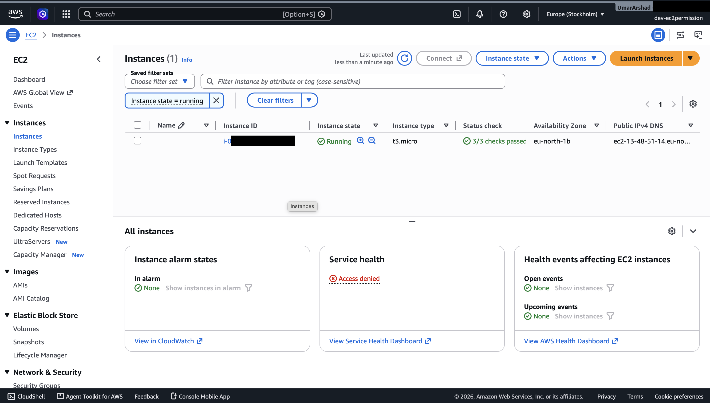
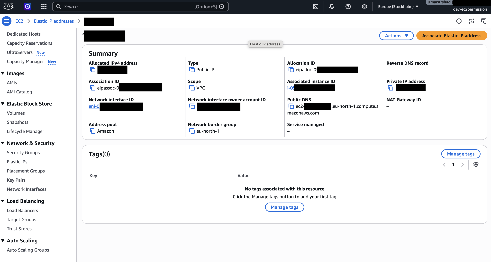
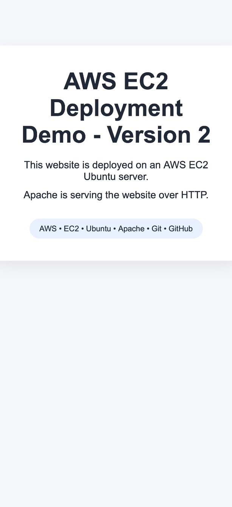
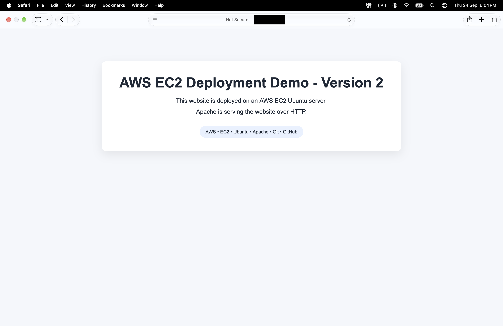
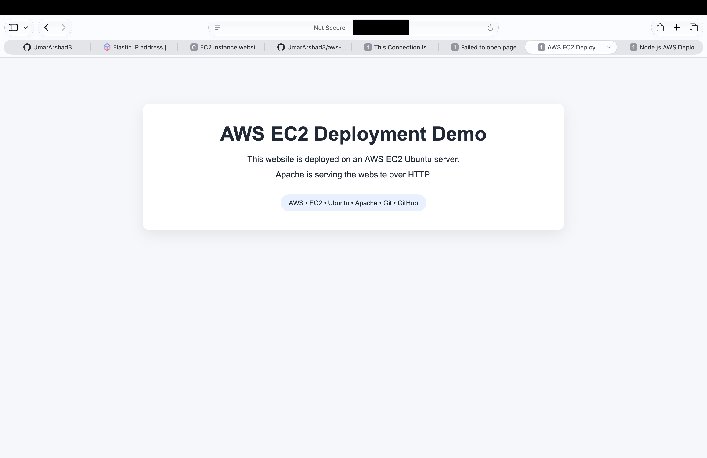
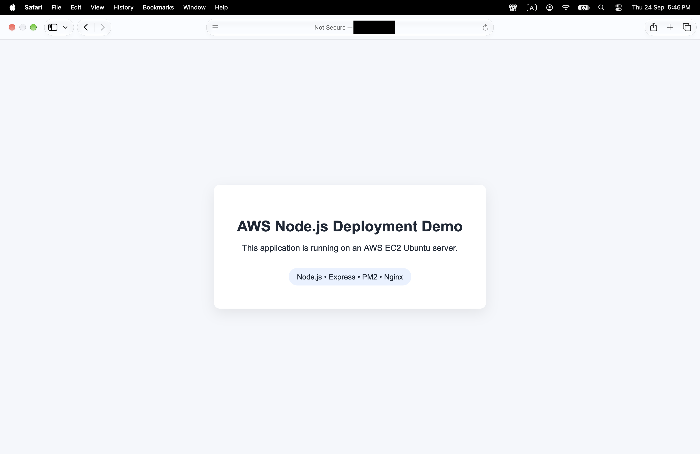

# AWS EC2 Website Deployment

A static website deployed on an AWS EC2 Ubuntu server using Apache HTTP Server. This project demonstrates cloud server provisioning, Linux administration, web server configuration, and deployment verification.

## Project Overview

The website runs on Ubuntu 24.04 LTS with Apache serving the HTML and CSS files. A dedicated Apache Virtual Host is configured to serve the project from its own document root.

## Architecture

```text
Visitor's Browser
       |
       | HTTP :80
       v
AWS EC2 — Ubuntu 24.04 LTS
       |
       v
Apache HTTP Server
       |
       v
/var/www/cloud-deployment-demo/public
       |
       v
HTML + CSS Website
```

## Technologies Used

- AWS EC2
- Ubuntu 24.04 LTS
- Apache HTTP Server
- HTML5 and CSS3
- Git and GitHub

## AWS Configuration

### EC2 Instance

- Operating system: Ubuntu 24.04 LTS
- AWS Region: Europe (Stockholm)
- Storage: 8 GiB gp3
- Public IPv4 enabled

### Security Group

| Protocol | Port | Source | Purpose |
|---|---:|---|---|
| SSH | 22 | Administrator's IP | Server administration |
| HTTP | 80 | `0.0.0.0/0` | Public website access |
| HTTPS | 443 | `0.0.0.0/0` | Intended for future HTTPS setup |

SSH access is restricted to the administrator's IP address. HTTP is publicly accessible.

**HTTPS note:** Port 443 being allowed by the Security Group does not enable HTTPS on its own. A TLS certificate and Apache HTTPS configuration are still required.

## Deployment

### 1. Update Ubuntu

```bash
sudo apt update
```

### 2. Install Apache

```bash
sudo apt install apache2 -y
```

### 3. Verify Apache

```bash
sudo systemctl status apache2
```

### 4. Deploy Website Files

The initial deployment copied the website files into Apache's document root:

```bash
sudo cp index.html style.css /var/www/html/
```

The project was subsequently configured to use a dedicated Virtual Host and document root at `/var/www/cloud-deployment-demo/public`.

### 5. Test the Website Locally

```bash
curl http://localhost
```

The website was also accessed through the EC2 public IPv4 address from a web browser.

## Apache Virtual Host

A dedicated Virtual Host was configured for the project.

- Server name: `cloud-deployment-demo.local`
- Document root: `/var/www/cloud-deployment-demo/public`
- Apache default site disabled
- Configuration validated with `apache2ctl configtest`
- Apache reloaded after configuration

The Virtual Host was tested locally using:

```bash
curl -H "Host: cloud-deployment-demo.local" http://localhost
```

The website was also verified through the EC2 public IPv4 address.

## Deployment Screenshots

### EC2 Instance



### Elastic IP Configuration



### Apache Service



### Website Served over HTTP



### Ubuntu Deployment



### Application Deployment



## Project Structure

```text
cloud-deployment-demo/
├── index.html
├── style.css
├── README.md
└── docs/
    └── screenshots/
        ├── app-ubuntu-deploy.png
        ├── ec2-running.png
        ├── elastic-ip.png
        ├── website-apache2-live.png
        ├── website-live-apache-http.png
        └── Website-ubuntu-deploy.png
```

## Testing and Current Status

- EC2 instance launched and running
- Apache installed and running
- Website HTML and CSS deployed
- Dedicated Apache Virtual Host configured
- Apache configuration validated
- Website tested locally with `curl`
- Website accessed successfully through the public IPv4 address
- Source code version-controlled with Git and published on GitHub

## Future Improvements

- Connect a custom domain
- Enable HTTPS with a TLS certificate
- Automate deployments
- Containerize the application with Docker
- Add CI/CD using GitHub Actions

## Author

[UmarArshad3](https://github.com/UmarArshad3)
